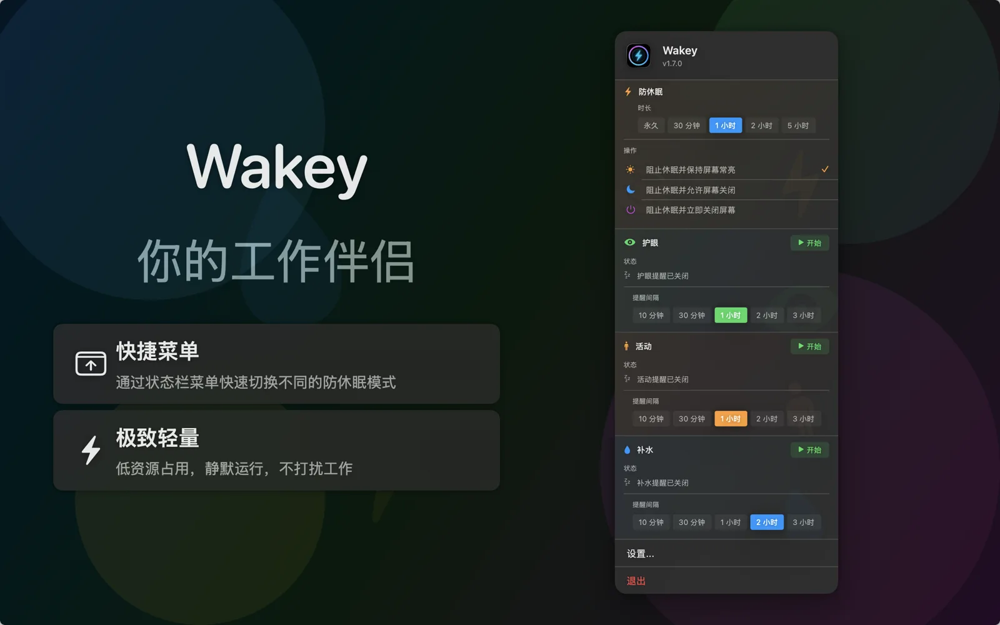

# Wakey

Wakey is a lightweight macOS status bar assistant.

📖 [中文版](README_zh.md) | English

[](https://swift.org)
[](https://developer.apple.com/macos/)
[](LICENSE)



## ✨ Features

Wakey is designed to be your capable macOS status bar assistant, offering the following core capabilities:

- **Caffeinate Control**: Prevent system sleep with a single click, featuring flexible modes and timers to ensure important tasks aren't interrupted.
- **Status Bar Assistant**: Persistent access to features directly from the menu bar, without switching context.
- **Modular Design**: Built with a plugin-based architecture, making it easy to extend with new features.
- **Personalized Experience**: Enable or disable features in settings to tailor Wakey to your specific needs.

## 📋 Requirements

- macOS 14.0+
- Xcode 15.0+
- Swift 5.9+

## 🛠 Development

```sh
open Wakey.xcodeproj   # select the Wakey scheme and run
```

### Project layout

- `WakeyApp/` — app target, `Wakey-Info.plist` and assets
- `Packages/FactoryWakey/` — kernel and plugin assembly used by the app
- `Packages/Kit*` — shared kits (reminders, logging, layout, background)
- `Packages/Plugin*`, `Packages/Provider*` — first-party plugins and providers
- `docs/metadata/` — App Store metadata (keywords, description)

### Tests

Each feature package has its own test target:

```sh
cd Packages/PluginCaffeinate
swift test
```

Run every package's suite:

```sh
./scripts/test-all-packages.sh
```

UI tests live in `WakeyUITests/` and run from Xcode against a built app.

## 📄 License

This project is licensed under the MIT License - see [LICENSE](LICENSE) for details.
