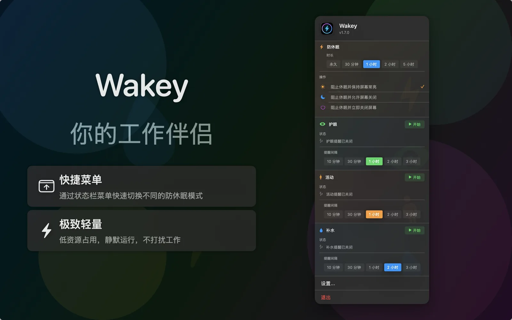

# Wakey

Wakey 是一款轻量级的 macOS 状态栏助手。

📖 中文版 | [English](README.md)

[](https://swift.org)
[](https://developer.apple.com/macos/)
[](LICENSE)



## ✨ 功能特性

Wakey 致力于成为你得力的 macOS 状态栏助理，提供以下核心能力：

- **防休眠控制**：一键阻止系统休眠，支持灵活的模式切换与时长设置，确保重要任务不因息屏而中断。
- **休息提醒**：护眼、喝水、拉伸三类提醒，间隔可自定义，并在每块屏幕上展示全屏休息遮罩。
- **状态栏助理**：在菜单栏常驻，无需切换窗口即可快速访问各项功能。
- **模块化设计**：采用插件化架构，易于扩展更多功能模块。
- **个性化体验**：根据个人需求在设置中灵活开启或关闭各项功能，打造专属的助理界面。

## 📋 系统要求

- macOS 14.0+
- Xcode 16.0+
- Swift 6.0+

## 🛠 开发

```sh
open Wakey.xcodeproj   # 选择 Wakey scheme 运行
```

### 项目结构

- `WakeyApp/` —— App target、`Wakey-Info.plist` 与资源
- `Packages/FactoryWakey/` —— App 使用的 kernel 与插件装配
- `Packages/Kit*` —— 共享套件（提醒、日志、布局、背景）
- `Packages/Plugin*`、`Packages/Provider*` —— 一方插件与 provider
- `docs/metadata/` —— App Store 元数据（关键词、描述）

### 测试

每个功能包都有独立测试目标：

```sh
cd Packages/PluginCaffeinate
swift test
```

运行全部包的测试：

```sh
./scripts/test-all-packages.sh
```

UI 测试位于 `WakeyUITests/`，在 Xcode 中针对已构建的 App 运行。

## 📄 许可证

本项目采用 GNU 通用公共许可证 v3.0（GPL-3.0） - 查看 [LICENSE](LICENSE) 文件了解详情。
